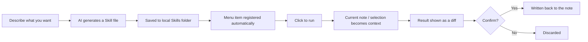

# SkillFlow

**Turn AI Skills into one-click menu items inside Obsidian.** No chat window, no re-typing the same prompt — every Skill acts on your current note (or selection) the moment you click it.

## Why

Existing ways to use AI in Obsidian all add friction:

| Approach | Problem |
| --- | --- |
| AI chat plugins | You retype the same instructions every time |
| Prompt-template plugins | Just text snippets — no execution or output handling |
| Command palette | You have to remember and search for commands |

SkillFlow's premise: **AI should live inside the tools you already use, not force you into a chat window.**

## How it works

A Skill is a plain Markdown file with metadata + instructions. Installed Skills show up in a menu from the status bar icon or the ribbon icon. Click one and SkillFlow sends your current note (or selection) to the configured model, then shows you a diff before writing anything back.



### Two built-in Skills

- **笔记纠错 (Fix spelling)** — proofreads the current note or selection and corrects typos, punctuation, and grammar.
- **标签整理 (Organize tags)** — reads the note, suggests tags, merges them with any existing `tags` in the frontmatter (de-duplicated, case-insensitive), and writes the result back after you confirm.

Both appear permanently in the menu alongside any Skills you create.

## Creating a Skill

Click "新建 Skill" in the plugin settings and describe what you want in one sentence (e.g. "把笔记翻译成英文" or "根据笔记内容生成待办清单"). An AI wizard turns that into a draft — name, icon, instructions, and output behavior — asking at most one clarifying question when something is ambiguous. You can:

- **Test run** the draft against your currently open note before saving (preview only, nothing is written).
- **Edit the raw Markdown** directly if a field needs manual correction.
- **Save**, which writes the Skill to `<Vault>/SkillFlow/skills/<id>/SKILL.md` and makes it show up in the menu immediately.

Saved Skills can be edited (opens the underlying Markdown file), duplicated, or deleted from the management list.

## Skill file format

Each Skill lives in its own folder as `SKILL.md`, with YAML frontmatter plus an `# Instructions` section. Template variables get substituted with the current note's content before the model runs: `{{note}}`, `{{selection}}`, `{{target}}` (selection if present, else the whole note), `{{title}}`, `{{path}}`, `{{date}}`, `{{lang}}`, and `{{frontmatter.<key>}}`.

```markdown
---
id: translate-note
name: Translate Note
description: Translate the current note or selection into Chinese
icon: languages
version: 1.0.0
context: [note, selection]
tools: []
output:
  mode: replace_target
  confirm: diff
---

# Instructions

Translate {{target}} into Chinese.

Requirements:
- Preserve Markdown formatting.
- Keep code blocks unchanged.
- Translate technical terms accurately; keep the English term when needed.
- Do not translate URLs.
```

Output modes: `replace_target` (replace the selection, or the whole note if nothing is selected), `insert_after`, `append`, `new_note` (creates a new note with the result), or `modal` (show the result in a popup without writing anything). Any mode that modifies a note defaults to `confirm: diff`, which previews the change as a side-by-side diff before it's written; setting `confirm: none` skips that preview.

## Model providers

SkillFlow runs Skills through a model you configure in settings. Supported providers:

- OpenAI
- Anthropic
- OpenRouter
- DeepSeek
- Ollama (local)
- Any OpenAI-compatible endpoint (custom base URL)

Add a provider, enter its API key (and base URL for custom/local endpoints), and pick a default model — SkillFlow can fetch the live list of models from the provider's API. A Skill runs on the first configured provider that has a key and model set.

## Writes are controlled

- Any Skill output that would modify a note is shown as a diff (before/after, with character-level highlighting) and only applied after you confirm.
- Note content is sent to the model as plain text content, not as instructions the model should follow.
- API keys are stored in local plugin data.

## Contributing

Issues and PRs are welcome. See [`SKILL_CREATION_GUIDE.md`](./SKILL_CREATION_GUIDE.md) for the internal spec that drives the AI-assisted Skill-creation wizard.

## License

[MIT](./LICENSE)
