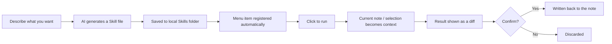

# SkillsFlow

**Turn AI Skills into one-click menu items inside Obsidian.** No chat window, no re-typing the same prompt — every Skill acts on your current note (or selection) the moment you click it.

> ⚠️ **Status: early concept / pre-alpha.** SkillsFlow is currently a product spec (see [`TODO.md`](./TODO.md)) with no working code yet. This repo tracks the design and will grow into an actual Obsidian plugin starting with the V0.1 milestone below.

## Why

Existing ways to use AI in Obsidian all add friction:

| Approach | Problem |
| --- | --- |
| AI chat plugins | You retype the same instructions every time |
| Prompt-template plugins | Just text snippets — no execution, output handling, or permissions |
| Command palette | You have to remember and search for commands |
| External agents / MCP | Doesn't naturally see your current note or selection |

SkillsFlow's premise: **AI should live inside the tools you already use, not force you into a chat window.**

## How it works

A Skill is a plain Markdown file with metadata + instructions. Installed Skills show up as menu items. Click one and SkillsFlow builds context from your current note, runs the model, and shows you a diff before writing anything back.



## Core concepts

| Concept | Meaning |
| --- | --- |
| **Skill** | A Markdown file with metadata + execution instructions; appears as one menu item |
| **Context** | What a Skill can see when it runs — current note, selection, frontmatter |
| **Tool** | A capability a Skill may call — read note, edit note, search vault, etc. |
| **Output** | How a result lands — replace selection, insert after, append, new note, or preview-only |
| **Permission** | The set of capabilities a Skill declares and the user grants |
| **Registry** | Loads, installs, updates, and enables/disables local Skills |
| **Runtime** | Builds context, calls the LLM, executes tools, and applies output |
| **Pin** | A Skill the user has pinned to the quick-access menu |

## Skill file format

Each Skill lives in its own folder as `SKILL.md`, with YAML frontmatter plus an `# Instructions` section. Template variables like `{{note}}`, `{{selection}}`, and `{{target}}` (selection if present, else the whole note) get substituted at run time.

```markdown
---
id: translate-note
name: Translate Note
description: Translate the current note or selection into Chinese
icon: languages
category: writing
version: 1.0.0
context: [note, selection]
tools: []
output:
  mode: replace_target
  confirm: diff
---

# Instructions

Translate {{target}} into Chinese.

Requirements:
- Preserve Markdown formatting.
- Keep code blocks unchanged.
- Translate technical terms accurately; keep the English term when needed.
- Do not translate URLs.

# Output

Output only the translated text, with no extra explanation.
```

Skills that need tools (reading linked notes, searching the vault, creating notes, etc.) declare the `tools` and `permissions` they need, and the user is asked to approve those permissions before the Skill can use them.

## Design principles

1. **Click to run** — the core path has no input box and no required parameters.
2. **Current note first** — a Skill's default scope is the active note; anything wider must be declared explicitly.
3. **A Skill is more than a prompt** — it bundles instructions, context, tools, and output behavior.
4. **Writes are controlled** — any note modification previews a diff, requires confirmation, and stays undoable.
5. **Least privilege by default** — installing a Skill never implies full vault access.
6. **Files are the source of truth** — Skills are human-readable Markdown, Git-friendly, and hand-editable.
7. **Ship the loop before the ecosystem** — V0.1 has no marketplace and no complex DSL.

## Roadmap

| Stage | Scope | Goal |
| --- | --- | --- |
| **V0.1** | Local Skills, menu trigger, current-note context, diff-confirmed writes | Validate the core experience |
| **V0.2** | AI-assisted Skill creation, editing, import/export, permission prompts | Validate the authoring experience |
| **V0.3** | Online marketplace, search, download, update, ratings | Bootstrap an ecosystem |
| **V1.0** | Paid Skills, author profiles, cross-app Skill standard | Platform |

See [`TODO.md`](./TODO.md) for the full product spec, including entry points, interaction flows, the Skill schema, the permission model, and the V0.1 task breakdown.

## Security & permissions

SkillsFlow treats any downloaded Skill as untrusted by default:

- Permissions are deny-by-default and must be declared in frontmatter; the user grants them explicitly on first run.
- Every tool call is re-checked against granted permissions at runtime — a model can't talk its way around a declared scope.
- Note content is passed to the model as data, with an explicit instruction that embedded text is not to be treated as commands (defense against prompt injection).
- Writes default to a diff-confirm step; `confirm: none` must be turned on per-Skill by the user.
- API keys stay in local plugin data and are never included when exporting a Skill.

See section 11 of [`TODO.md`](./TODO.md) for the full threat model and permission levels (L0–L4).

## Contributing

This project is pre-code — the most useful contribution right now is feedback on the spec in [`TODO.md`](./TODO.md), particularly the open questions in section 18 (Skill directory location, compatibility with Anthropic's `SKILL.md` format, multi-provider support, mobile support).

Once V0.1 scaffolding lands, issues and PRs against the task list in section 14.1 will be welcome.

## License

[MIT](./LICENSE)
